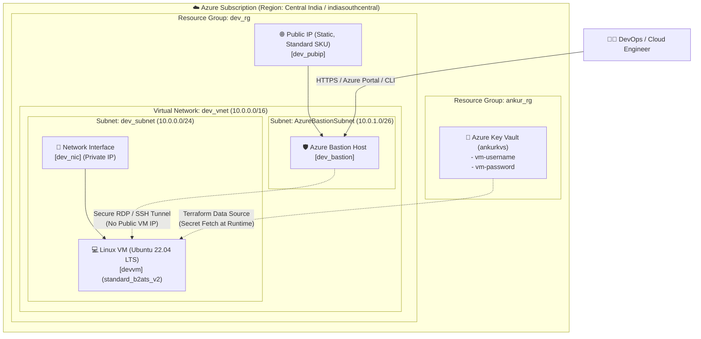

# 🛡️ Azure Enterprise Secure Landing Zone (Terraform)

[](https://www.terraform.io/)
[](https://registry.terraform.io/providers/hashicorp/azurerm/latest)
[](https://azure.microsoft.com/en-us/products/key-vault/)
[](https://ubuntu.com/)
[](https://azure.microsoft.com/en-us/products/azure-bastion/)

An enterprise-grade, modular, and secure **Azure Landing Zone** built using **Terraform**. This landing zone automates the provisioning of core networking, isolated compute infrastructure, bastion connectivity, and adheres to the **Principle of Least Privilege** and **Zero-Trust Security** by sourcing VM credentials dynamically from **Azure Key Vault** without any plain-text secrets in code or version control.

---

## 📑 Table of Contents
- [Architecture Overview](#-architecture-overview)
- [Key Features](#-key-features)
- [Repository Structure](#-repository-structure)
- [Infrastructure Components](#-infrastructure-components)
- [Security Architecture & Key Vault Integration](#-security-architecture--key-vault-integration)
- [Prerequisites](#-prerequisites)
- [Step-by-Step Deployment Guide](#-step-by-step-deployment-guide)
- [Connecting to Virtual Machine via Bastion](#-connecting-to-virtual-machine-via-bastion)
- [Modules Reference](#-modules-reference)
- [Input Variables & Configuration (`terraform.tfvars`)](#-input-variables--configuration-terraformtfvars)
- [Best Practices Implemented](#-best-practices-implemented)
- [Teardown / Cleanup](#-teardown--cleanup)
- [Contributing & License](#-contributing--license)

---

## 🏛️ Architecture Overview

The Landing Zone deploys a secure **Virtual Network (VNet)** segmented into dedicated subnets. Compute resources (Linux VMs) reside inside a private subnet with **zero public IP exposure**. Ingress administrative access is guarded by an **Azure Bastion Host**, and VM administrative credentials are dynamically fetched at runtime from a pre-configured **Azure Key Vault**.



---

## ✨ Key Features

- 🔐 **Zero Hardcoded Secrets**: VM credentials (`admin_username` & `admin_password`) are injected dynamically via `data "azurerm_key_vault_secret"` from Azure Key Vault.
- 🛡️ **Zero Public Exposure for Compute**: The Linux Virtual Machine has **no public IP address**. It is entirely isolated within a private subnet.
- 🚀 **Managed Bastion Connectivity**: Seamless browser-based and Azure CLI-based SSH access through **Azure Bastion Host**, eliminating the need for jump-boxes or exposed Port 22.
- 🧩 **100% Modular & Scalable**: Modular architecture using `for_each` maps (`var.x`), enabling you to deploy 1 or 100 resources with a single line of config change.
- 📁 **Environment-Separated Structure**: Clean separation between reusable child modules (`module/`) and environment configurations (`environment/preprod`).
- ⚡ **Explicit Dependency Graph**: Deterministic deployment order using `depends_on` ensuring Resource Groups, VNets, Subnets, and PIPs are available before dependent hosts.

---

## 📂 Repository Structure

```text
keyvault 18oct/
├── README.md                                # Comprehensive Project Documentation
├── environment/
│   └── preprod/                             # Pre-production Environment Configuration
│       ├── main.tf                          # Root module calling all child modules
│       ├── provider.tf                      # Azurerm provider & version constraints
│       ├── variable.tf                      # Root input variable declarations
│       ├── terraform.tfvars                 # Environment-specific configuration values
│       ├── terraform.tfstate                # Local Terraform state file (use remote backend in prod)
│       └── .terraform.lock.hcl              # Provider dependency lock file
└── module/                                  # Reusable Child Modules
    ├── azurerm_rg/                          # Azure Resource Group Module
    │   ├── main.tf
    │   └── variable.tf
    ├── azurm_vnet/                          # Azure Virtual Network Module
    │   ├── main.tf
    │   └── variable.tf
    ├── azurerm_subnet/                      # Azure Subnet Module
    │   ├── main.tf
    │   └── variable.tf
    ├── azurerm_publicip/                    # Azure Public IP Module (Static / Standard)
    │   ├── main.tf
    │   └── variable.tf
    ├── azurerm_bastion/                     # Azure Bastion Host Module
    │   ├── main.tf
    │   ├── data.tf                          # Data lookups for PIP & Subnet
    │   └── variable.tf
    └── azurerm_virtual_machine/             # Azure Linux VM & NIC Module
        ├── main.tf                          # NIC & Linux VM resources
        ├── data.tf                          # Key Vault & Subnet secret lookups
        └── variable.tf
```

---

## 🧱 Infrastructure Components

| Component | Resource Type | Purpose | Configuration / SKU |
| :--- | :--- | :--- | :--- |
| **Resource Group** | `azurerm_resource_group` | Logical container for workload resources | `dev_rg` @ `indiasouthcentral` |
| **Virtual Network** | `azurerm_virtual_network` | Primary network boundary | `dev_vnet` (`10.0.0.0/16`) |
| **Workload Subnet** | `azurerm_subnet` | Host subnet for VMs and application services | `dev_subnet` (`10.0.0.0/24`) |
| **Bastion Subnet** | `azurerm_subnet` | Dedicated subnet for Azure Bastion | `AzureBastionSubnet` (`10.0.1.0/26`) |
| **Public IP** | `azurerm_public_ip` | Static public IP assigned strictly to Bastion | `dev_pubip` (Standard SKU, Static) |
| **Bastion Host** | `azurerm_bastion_host` | Secure remote access gateway | `dev_bastion` |
| **Network Interface** | `azurerm_network_interface` | Virtual NIC for Linux VM | `dev_nic` (Dynamic Private IP) |
| **Virtual Machine** | `azurerm_linux_virtual_machine` | Compute Workload | `devvm` (`standard_b2ats_v2`, Ubuntu 22.04 LTS) |
| **Key Vault Lookups** | `azurerm_key_vault_secret` | Dynamic secret injection | Sourced from `ankurkvs` in `ankur_rg` |

---

## 🔒 Security Architecture & Key Vault Integration

### How Secrets are Managed Securely:
Rather than storing plain-text usernames and passwords in `terraform.tfvars` or passing them via CLI flags:
1. An administrator creates an Azure Key Vault (`ankurkvs`) in resource group `ankur_rg`.
2. Two secrets are stored:
   - `vm-username` (e.g., `azureuser` or `devadmin`)
   - `vm-password` (Strong 16+ character password meeting complexity requirements)
3. In `module/azurerm_virtual_machine/data.tf`, Terraform queries Key Vault directly:
   ```hcl
   data "azurerm_key_vault" "kvs" {
     name                = "ankurkvs"
     resource_group_name = "ankur_rg"
   }

   data "azurerm_key_vault_secret" "username" {
     name         = "vm-username"
     key_vault_id = data.azurerm_key_vault.kvs.id
   }

   data "azurerm_key_vault_secret" "password" {
     name         = "vm-password"
     key_vault_id = data.azurerm_key_vault.kvs.id
   }
   ```
4. The VM consumes these secrets at provision time without emitting credentials to logs:
   ```hcl
   admin_username                  = data.azurerm_key_vault_secret.username.value
   admin_password                  = data.azurerm_key_vault_secret.password.value
   disable_password_authentication = false
   ```

> [!TIP]
> Ensure the identity executing Terraform (Service Principal or user account logged in via Azure CLI) has **Key Vault Secrets User** or **Key Vault Secrets Officer** role on the target Key Vault.

---

## ⚙️ Prerequisites

Before provisioning the infrastructure, ensure you have:

1. **Terraform**: `>= 1.0.0` installed ([Download Terraform](https://developer.hashicorp.com/terraform/downloads)).
2. **Azure CLI**: `>= 2.50.0` installed ([Install Azure CLI](https://learn.microsoft.com/en-us/cli/azure/install-azure-cli)).
3. **Active Azure Subscription** with Contributor/Owner permissions.
4. **Pre-existing Azure Key Vault** containing the required secrets:
   - Key Vault Name: `ankurkvs`
   - Resource Group: `ankur_rg`
   - Secret 1: `vm-username`
   - Secret 2: `vm-password`

---

## 🚀 Step-by-Step Deployment Guide

### Step 1: Clone Repository & Authenticate to Azure
```bash
# Login to Azure
az login

# List your subscriptions and set the desired active subscription
az account list --output table
az account set --subscription "<YOUR_SUBSCRIPTION_ID_OR_NAME>"
```

### Step 2: Prepare Key Vault & Secrets (If not already created)
```bash
# Create RG for Key Vault
az group create --name ankur_rg --location indiasouthcentral

# Create Key Vault
az keyvault create --name ankurkvs --resource-group ankur_rg --location indiasouthcentral

# Set Admin Username & Password Secrets
az keyvault secret set --vault-name ankurkvs --name "vm-username" --value "azureuser"
az keyvault secret set --vault-name ankurkvs --name "vm-password" --value "P@ssw0rdSecure123!"
```

### Step 3: Navigate to the Target Environment
```bash
cd environment/preprod
```

### Step 4: Initialize Terraform
Initializes the backend and downloads the required HashiCorp AzureRM provider plugins:
```bash
terraform init
```

### Step 5: Validate Configuration & Check Execution Plan
```bash
# Check syntax and configuration integrity
terraform validate

# Generate and review execution plan
terraform plan
```

### Step 6: Apply the Configuration
Provision the infrastructure:
```bash
terraform apply -auto-approve
```

---

## 🔑 Connecting to Virtual Machine via Bastion

Since the VM does not have a public IP, use Azure Bastion for secure terminal access:

### Method 1: Via Azure Portal (Browser-Based)
1. Navigate to **Azure Portal** -> **Virtual Machines** -> Select `devvm`.
2. Under the **Connect** menu on the left, click **Bastion**.
3. Select **Use Bastion**.
4. Enter the credentials stored in your Key Vault (`vm-username` and `vm-password`).
5. Click **Connect** to open a secure browser-based SSH terminal.

### Method 2: Via Azure CLI (Native SSH via Bastion Tunnel)
```bash
az network bastion ssh \
  --name "devbastion" \
  --resource-group "dev_rg" \
  --target-resource-id "/subscriptions/<SUB_ID>/resourceGroups/dev_rg/providers/Microsoft.Compute/virtualMachines/devvm" \
  --auth-type "password" \
  --username "<YOUR_KV_USERNAME>"
```

---

## 🧩 Modules Reference

Each module is designed with `for_each = var.x` iteration, accepting maps of objects for flexible resource creation.

### 1. `azurerm_rg`
- **Path**: `../../module/azurerm_rg`
- **Purpose**: Provisions Azure Resource Groups.
- **Attributes per item**: `resource_group_name`, `location`.

### 2. `azurm_vnet`
- **Path**: `../../module/azurm_vnet`
- **Purpose**: Provisions Azure Virtual Networks.
- **Attributes per item**: `virtual_network_name`, `location`, `resource_group_name`, `address_space`.

### 3. `azurerm_subnet`
- **Path**: `../../module/azurerm_subnet`
- **Purpose**: Provisions Subnets (workload subnets & `AzureBastionSubnet`).
- **Attributes per item**: `subnet_name`, `resource_group_name`, `virtual_network_name`, `address_prefixes`.

### 4. `azurerm_publicip`
- **Path**: `../../module/azurerm_publicip`
- **Purpose**: Standard SKU Static Public IP address for Bastion Host.
- **Attributes per item**: `pubip_name`, `resource_group_name`, `location`.

### 5. `azurerm_bastion`
- **Path**: `../../module/azurerm_bastion`
- **Purpose**: Managed Azure Bastion Host service.
- **Lookups**: Dynamically looks up target subnet ID and public IP ID via data sources.
- **Attributes per item**: `bastion_name`, `location`, `resource_group_name`, `subnet_name`, `virtual_network_name`, `pubip_name`.

### 6. `azurerm_virtual_machine`
- **Path**: `../../module/azurerm_virtual_machine`
- **Purpose**: Network Interface Card (NIC) and Linux Virtual Machine (Ubuntu 22.04 LTS).
- **Lookups**: Dynamically queries Key Vault for credentials and Subnet for NIC attachment.
- **Attributes per item**: `vm_name`, `size`, `location`, `resource_group_name`, `virtual_network_name`, `subnet_name`, `nic_name`.

---

## ⚙️ Input Variables & Configuration (`terraform.tfvars`)

The pre-production environment is preconfigured in [terraform.tfvars](file:///c:/Users/gaura/Downloads/terraformpractice/keyvault%2018oct/environment/preprod/terraform.tfvars):

```hcl
resource_group = {
  dev = {
    resource_group_name = "dev_rg"
    location            = "indiasouthcentral"
  }
}

virtual_network = {
  dev = {
    virtual_network_name = "dev_vnet"
    location             = "indiasouthcentral"
    resource_group_name  = "dev_rg"
    address_space        = ["10.0.0.0/16"]
  }
}

subnet = { 
  dev = {
    subnet_name          = "dev_subnet"
    virtual_network_name = "dev_vnet"
    resource_group_name  = "dev_rg"
    address_prefixes     = ["10.0.0.0/24"]
  }
  bastion = {
    subnet_name          = "AzureBastionSubnet"
    virtual_network_name = "dev_vnet"
    resource_group_name  = "dev_rg"
    address_prefixes     = ["10.0.1.0/26"]  
  }
}

azurebastion = {
  dev = {
    subnet_name          = "AzureBastionSubnet"
    virtual_network_name = "dev_vnet"
    bastion_name         = "dev_bastion"
    resource_group_name  = "dev_rg"
    pubip_name           = "dev_pubip"  
    location             = "indiasouthcentral"
  }
}

publicip = {
  dev = {
    pubip_name          = "dev_pubip"
    resource_group_name = "dev_rg"
    location            = "indiasouthcentral"
    allocation_method   = "Static"
    sku                 = "Standard"
  }
}

virtualmachine = {
  dev = {
    subnet_name          = "dev_subnet"
    virtual_network_name = "dev_vnet"
    nic_name             = "dev_nic"
    location             = "indiasouthcentral"
    resource_group_name  = "dev_rg"
    vm_name              = "devvm"
    size                 = "standard_b2ats_v2"
  }
}
```

---

## 🏆 Best Practices Implemented

- [x] **No Plaintext Passwords**: Credentials are never committed to GitHub or hardcoded into `.tfvars`.
- [x] **Zero-Trust Network Model**: VMs are not exposed to the public internet; Bastion acts as the sole access gateway.
- [x] **Strict Subnet Sizing**: `AzureBastionSubnet` uses `/26` prefix as required by Microsoft Azure standards.
- [x] **Standard SKU Public IPs**: Ensures high availability and zone resiliency compatibility.
- [x] **Predictable Resource Dependencies**: Modules define explicit `depends_on` relationships to avoid race conditions during parallel provisioning.
- [x] **DRY (Don't Repeat Yourself)**: Using `for_each = var.x` throughout all modules allows infinite scalability without code duplication.

---

## 🧹 Teardown / Cleanup

To avoid unnecessary Azure consumption charges when you are done testing, destroy all resources in the reverse order of creation:

```bash
cd environment/preprod
terraform destroy -auto-approve
```

---

## 🤝 Contributing & License

Feel free to open issues or submit pull requests for enhancements, such as:
- Adding Network Security Groups (NSGs) with default deny rules.
- Transitioning local state to Azure Storage Account Remote Backend (`azurerm` backend).
- Adding automated linting with `tflint` and security scanning with `tfsec` / `checkov`.
